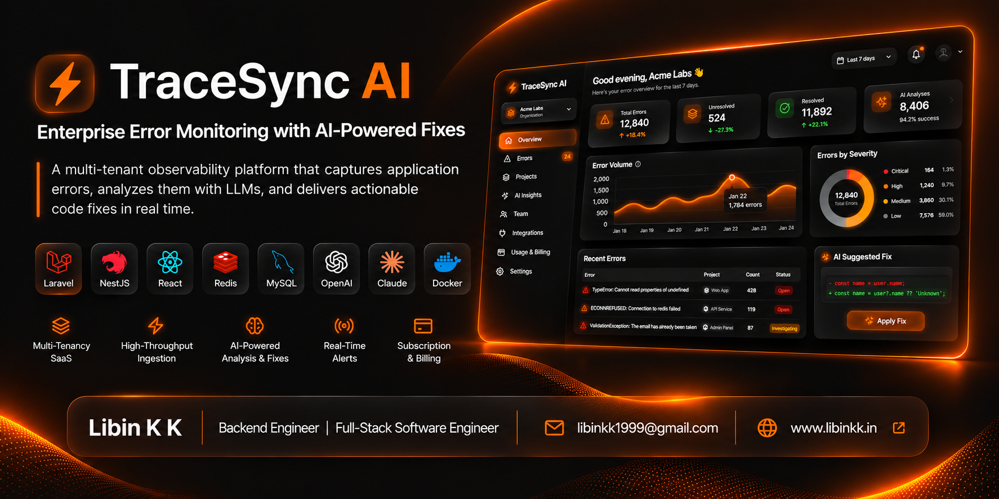
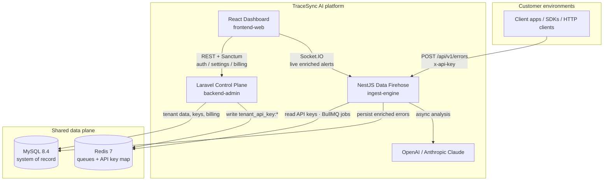
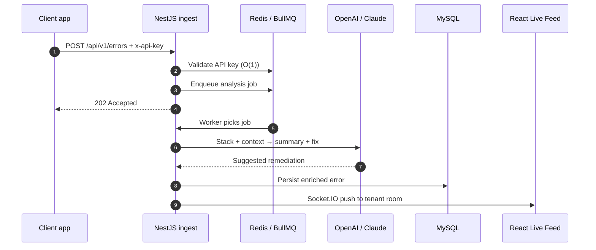

<p align="center">
  
</p>

# TraceSync AI

### Enterprise error monitoring that ships the fix, not just the stack trace

**TraceSync AI** is a B2B observability SaaS for engineering teams. It ingests application errors at high volume, enriches them asynchronously with LLMs (OpenAI / Claude), and delivers **AI-suggested code fixes** to a live dashboard - so developers spend less time hunting crashes and more time shipping.

Think **Sentry-class capture**, **Datadog-class multi-tenancy**, and **LLM-native remediation** in one product.

<p align="center">
  
  
  
  
  
  
  
  
</p>

> **How to read this document**
>
> | Audience | Start here |
> |----------|------------|
> | **CEO / business** | [Executive brief](#1-executive-brief-ceo--business) |
> | **CTO / architecture** | [Software architecture](#3-software-architecture-cto--tech-lead) |
> | **Engineering Manager** | [Delivery model & ownership](#4-delivery-model--ownership-engineering-manager) |
> | **Tech Lead / engineers** | [Monorepo map](#5-monorepo-map) → [Local setup](#7-local-setup-docker-compose) |

---

## Table of contents

1. [Executive brief (CEO / business)](#1-executive-brief-ceo--business)
2. [Product narrative (all leaders)](#2-product-narrative-all-leaders)
3. [Software architecture (CTO / Tech Lead)](#3-software-architecture-cto--tech-lead)
4. [Delivery model & ownership (Engineering Manager)](#4-delivery-model--ownership-engineering-manager)
5. [Monorepo map](#5-monorepo-map)
6. [libinkk ecosystem](#6-libinkk-ecosystem)
7. [Local setup (Docker Compose)](#7-local-setup-docker-compose)
8. [Service URLs](#8-service-urls)
9. [Environment reference](#9-environment-reference)
10. [Engineering principles](#10-engineering-principles)
11. [Docs & license](#11-docs--license)

---

## 1. Executive brief (CEO / business)

### What we sell

TraceSync AI helps software companies **detect production failures faster and resolve them with AI-assisted guidance**. Customers install a lightweight client (or call our ingest API), see crashes in a branded dashboard, and receive suggested code fixes generated by leading LLMs.

### Why the market cares

| Pain today | Business cost | TraceSync outcome |
|------------|---------------|-------------------|
| Alert fatigue from raw stack traces | Engineers waste hours triaging noise | AI summary + suggested fix on every error |
| Monitoring tools that choke under spikes | Lost visibility during incidents | Dedicated high-throughput ingest plane |
| Multi-tenant SaaS bolted onto a monolith | Security and billing risk | Tenant isolation, API keys, Razorpay subscriptions by design |
| Slow “time to understand” after a crash | Longer MTTR, customer churn | Live WebSocket feed of enriched alerts |

### Business model (high level)

- **B2B SaaS** with tenant (company) accounts and projects
- **Usage-aligned monetization** via subscription tiers (log volume) through **Razorpay**
- **API-key gated ingest** so each customer’s traffic is authenticated and attributable
- **AI enrichment** as the differentiation layer (not just storage of logs)

### Strategic thesis in one sentence

> Separate the money and trust plane (billing, tenants, permissions) from the firehose plane (ingest, AI, realtime), so the product can scale commercially and technically at the same time.

---

## 2. Product narrative (all leaders)

### The problem we refuse to ignore

Traditional “all-in-one” APIs mix business logic with log ingestion. Under a traffic spike:

1. Controllers block on database writes, email, or LLM calls  
2. Dashboards become slow  
3. Ingest starts timing out precisely when customers need visibility most  

### Our answer

TraceSync is built as **three cooperating services** in one monorepo:

| Service | Role in plain language |
|---------|------------------------|
| **Laravel (`laravel/`)** | The **control plane** - accounts, teams, projects, API keys, billing, permissions |
| **NestJS (`nestjs/`)** | The **data firehose** - accept errors fast, queue work, call AI, push live updates |
| **React (`react/`)** | The **operator dashboard** - configure the product and watch the live error feed |

### End-to-end customer journey

```text
  Customer app crashes
          │
          ▼
  POST error + API key  ──►  NestJS accepts quickly (202)
          │
          ▼
  Job queued on Redis/BullMQ  (hot path stays thin)
          │
          ▼
  AI worker (OpenAI or Claude) proposes a fix
          │
          ▼
  Result stored in MySQL + pushed over WebSocket
          │
          ▼
  Engineer sees crash + suggested fix in React Live Feed
```

Engineers do not wait for a digests email of raw frames. They get a **live, AI-enriched signal**.

---

## 3. Software architecture (CTO / Tech Lead)

### 3.1 System context (C4-style)



### 3.2 Logical planes

| Plane | Path (guideline) | Path (repo) | Owns |
|-------|------------------|-------------|---------|
| **Control plane** | `/backend-admin` | `laravel/` | Tenants, users, projects, Sanctum auth, API keys, Razorpay billing, RBAC/ABAC |
| **Data firehose** | `/ingest-engine` | `nestjs/` | Authenticated ingest API, BullMQ workers, AI analysis, Socket.IO live feed |
| **Operator UI** | `/frontend-web` | `react/` | Dark glass dashboard - Laravel for auth/settings, NestJS for live errors |

### 3.3 Component architecture (detailed)

```text
                         ┌──────────────────────────────────────┐
                         │        React Dashboard  :5173        │
                         │  Landing · Auth · Live Feed · Settings│
                         │  Projects · Billing checkout (Razorpay)│
                         └────────────┬─────────────┬───────────┘
                                      │             │
                          REST (Sanctum)         Socket.IO
                                      │             │
                                      ▼             ▼
              ┌────────────────────────────┐  ┌─────────────────────────────┐
              │  Laravel Control Plane     │  │  NestJS Data Firehose       │
              │           :8080            │  │           :3030             │
              │                            │  │                             │
              │  Modules (DDD / libinkk):  │  │  ingest/   - HTTP intake    │
              │   · Auth     (OneAuth)     │  │  ai/       - LLM providers  │
              │   · Tenant   (API keys)    │  │  dashboard/- Socket.IO GW   │
              │   · Project  (apps)        │  │  error-logs/- persistence   │
              │   · Billing  (Razorpay)    │  │  BullMQ workers (async)     │
              │  permission RBAC + ABAC    │  │                             │
              └─────────────┬──────────────┘  └──────────────┬──────────────┘
                            │                                │
                            │  API key sync (write)          │  API key lookup (read)
                            │  tenant_api_key:{key}→tenant   │  O(1) Redis validation
                            └────────────────┬───────────────┘
                                             ▼
                               ┌─────────────────────────────┐
                               │     Redis 7  ·  MySQL 8.4   │
                               │  queues · key map · durable │
                               │  business + enriched errors │
                               └─────────────────────────────┘
```

### 3.4 Why Redis sits in the middle

| Concern | Mechanism | Why it matters |
|---------|-----------|----------------|
| **Cross-service trust** | Laravel writes `tenant_api_key:{key} → tenant_id` on an unprefixed ingest Redis connection | NestJS validates `x-api-key` in microseconds - no Laravel round-trip per error |
| **Throughput under spikes** | NestJS returns `202`, enqueues **BullMQ** jobs | Spikes become queue depth, not HTTP timeouts or DB lock storms |
| **Durable truth** | MySQL stores tenants, projects, subscriptions, enriched errors | Redis accelerates and coordinates; it is not the system of record |

### 3.5 AI enrichment pipeline



| Step | What happens |
|------|----------------|
| **1. Capture** | Client posts a structured error payload to NestJS |
| **2. Authenticate** | NestJS resolves tenant via Redis API key map |
| **3. Queue** | Job lands on BullMQ - HTTP path stays thin |
| **4. Reason** | Worker calls OpenAI or Claude; provider switchable via `AI_PROVIDER` |
| **5. Persist** | Summary + suggested fix stored in MySQL |
| **6. Broadcast** | Dashboard gateway pushes the alert to the tenant room |

> **Graceful degradation:** if LLM keys are missing or a provider fails, workers fall back to a safe mock solution so ingest never hard-stops.

### 3.6 Tech stack (current)

| Layer | Choice | Notes |
|-------|--------|-------|
| Control plane | PHP 8.3+ / Laravel | Modular DDD via `libinkk/modular` |
| Ingest engine | Node.js / NestJS / TypeScript | High-concurrency HTTP + workers |
| Dashboard | React (Vite) / TypeScript / Tailwind | Dark glass UI system |
| Primary DB | MySQL 8.4 | Indexed, partition-ready for volume growth |
| Coordination | Redis 7 + BullMQ | Queues, key map, realtime fan-out support |
| Payments | Razorpay | Subscription tiers by log volume |
| AI | OpenAI / Anthropic Claude | Switchable provider for analysis |
| Runtime | Docker Compose | One-command local parity |

### 3.7 Design thesis (for architecture reviews)

> Business correctness belongs in Laravel. Throughput belongs in NestJS. Coordination belongs in Redis. Insight belongs to the LLM - never on the request thread.

---

## 4. Delivery model & ownership (Engineering Manager)

### Team boundary map

Use this as a default ownership model when staffing squads or on-call:

| Area | Primary owners | Adjacent consumers | Typical work |
|------|----------------|--------------------|--------------|
| `laravel/` control plane | Backend / platform | React (auth APIs), NestJS (key contract) | Tenants, RBAC, billing, API keys |
| `nestjs/` firehose | Ingest / realtime | React (WebSockets), AI vendors | Ingest SLA, queues, AI workers |
| `react/` dashboard | Frontend | Laravel + NestJS contracts | Live Feed, settings, projects UX |
| `docs/libinkk/` | Platform architects | All Laravel feature teams | Module patterns, auth, permissions |
| Infra (`docker-compose`, env) | Platform / DevOps | Everyone | Local parity, shared secrets shape |

### Risk and blast radius

| Change type | Blast radius | EM guidance |
|-------------|--------------|-------------|
| Laravel module feature | Control plane + React | Ship behind module boundaries; keep API envelopes stable |
| NestJS ingest / worker | Customer ingest SLA | Protect `202` latency; never put LLM calls on the request path |
| Redis key schema for API keys | Cross-service auth | Treat as a versioned contract between Laravel and NestJS |
| AI provider swap | Enrichment quality / cost | Config-driven (`AI_PROVIDER`); monitor fallback rate |
| Billing / Razorpay | Revenue path | Isolate in Billing module; verify webhooks in staging |

### Definition of done (leadership checklist)

- [ ] Hot-path ingest remains queue-backed (no sync LLM in controllers)  
- [ ] Tenant authorization enforced server-side (`libinkk/permission`)  
- [ ] API responses follow `libinkk/api-starter` envelopes on the control plane  
- [ ] New features land in the correct plane (control vs firehose vs UI)  
- [ ] Local reproduction via `docker compose up --build` still works  

### Scaling narrative for planning

1. **Now:** Compose-local, single MySQL + Redis, three app services  
2. **Next:** Horizontal NestJS workers, Redis HA, MySQL partitioning / read replicas for error tables  
3. **Later:** Managed queues, per-tenant rate limits, dedicated AI budget controls, multi-region ingest edge  

---

## 5. Monorepo map

```text
tracesync-ai/
├── docker-compose.yml          # Full local stack orchestration
├── .env.example                # Root Compose + shared secrets template
├── laravel/                    # Control plane (backend-admin)
│   ├── Modules/
│   │   ├── Auth/               # Register / login / profile (oneauth + Sanctum)
│   │   ├── Tenant/             # Orgs, API keys, Redis sync
│   │   ├── Project/            # Monitored applications
│   │   └── Billing/            # Razorpay subscriptions + webhooks
│   └── Dockerfile
├── nestjs/                     # Data firehose (ingest-engine)
│   ├── src/ingest/             # High-speed error intake
│   ├── src/ai/                 # OpenAI / Claude enrichment
│   ├── src/dashboard/          # Socket.IO gateway
│   ├── src/error-logs/         # Enriched error persistence
│   └── Dockerfile
├── react/                      # Operator UI (frontend-web)
│   ├── src/pages/              # Live Feed · Projects · Settings · Auth
│   ├── src/styles/             # color / style / responsive / animation
│   └── Dockerfile
└── docs/
    ├── libinkk/                # Package architecture docs
    └── postman/                # Ingest collection for smoke tests
```

---

## 6. libinkk ecosystem

The Laravel control plane is built on a deliberate open-source package suite for modular SaaS - not a sprawling MVC folder dump.

| Package | Role in TraceSync |
|---------|-------------------|
| [`libinkk/modular`](docs/libinkk/modular.md) | Domain modules (`Auth`, `Tenant`, `Project`, `Billing`) with auto-discovered routes, migrations, and providers |
| [`libinkk/oneauth`](docs/libinkk/oneauth.md) | Authentication backbone - Sanctum tokens, sessions, extensible drivers |
| [`libinkk/permission`](docs/libinkk/permission.md) | Enterprise **RBAC + ABAC**, tenant-scoped authorization, explainable allow/deny |
| [`libinkk/api-starter`](docs/libinkk/api-starter.md) | Uniform REST envelopes, validation errors, pagination, versioning (`X-API-Version`) |

**What that buys leadership:**

- Predictable module boundaries instead of a fat `app/Http` god-folder  
- Multi-tenant permission decisions that live in the backend, not in the UI  
- Stable API contracts for the React client and future SDKs  
- Billing, projects, and auth as first-class modules - not afterthoughts  

Official package docs: [`docs/libinkk/`](docs/libinkk/).

---

## 7. Local setup (Docker Compose)

### Prerequisites

- Docker Desktop (or Engine) with **Compose v2**
- Optional for native tooling: PHP 8.3+, Composer, Node.js 22+

### Boot the entire system

```bash
# 1. Clone
git clone <your-fork-or-remote> tracesync-ai
cd tracesync-ai

# 2. Environment examples
cp .env.example .env
cp laravel/.env.example laravel/.env
cp nestjs/.env.example nestjs/.env
cp react/.env.example react/.env
# Set OPENAI_API_KEY / ANTHROPIC_API_KEY for live AI
# Set RAZORPAY_KEY, RAZORPAY_SECRET, RAZORPAY_WEBHOOK_SECRET for billing

# 3. Align app envs for Compose (first run)
#    laravel/.env  → DB_HOST=mysql , REDIS_HOST=redis
#    nestjs/.env   → DB_HOST=mysql , REDIS_HOST=redis

# 4. Build and start everything
docker compose up --build
```

That single command brings up **MySQL**, **Redis**, **Laravel**, **NestJS**, and **React**.

### Everyday Compose commands

```bash
docker compose up -d          # detached
docker compose logs -f        # follow all services
docker compose logs -f nestjs # firehose only
docker compose down           # stop containers
docker compose down -v        # stop + wipe MySQL/Redis volumes
```

### First-time Laravel data

```bash
docker compose exec laravel php artisan migrate --seed
```

Seeded credentials (if using the project seeder) are documented in team notes; rotate before any shared environment.

---

## 8. Service URLs

| Surface | URL | Notes |
|---------|-----|--------|
| React dashboard | http://localhost:5173 | Live Feed, Projects, Members, Roles, Settings |
| Laravel API | http://localhost:8080 | Auth, tenants, projects, roles, billing webhook |
| NestJS ingest | http://localhost:3030 | `POST /api/v1/errors`, WebSockets |
| MySQL | `localhost:3306` | Shared system of record |
| Redis | `localhost:6379` | Queues + API key map |

**Smoke test ingest:** import [`docs/postman/TraceSync-Ingest-Error.postman_collection.json`](docs/postman/TraceSync-Ingest-Error.postman_collection.json) and send an error with a valid tenant `x-api-key` from Settings.

---

## 9. Environment reference

Copy each example before first run:

```bash
cp .env.example .env
cp laravel/.env.example laravel/.env
cp nestjs/.env.example nestjs/.env
cp react/.env.example react/.env
```

Root `.env` (Compose orchestration):

| Variable | Default | Purpose |
|----------|---------|---------|
| `MYSQL_DATABASE` | `tracesync` | Shared DB name |
| `MYSQL_USER` / `MYSQL_PASSWORD` | `tracesync` / `secret` | App DB credentials |
| `LARAVEL_PORT` | `8080` | Control plane host port |
| `NESTJS_PORT` | `3030` | Firehose host port |
| `REACT_PORT` | `5173` | Vite host port |
| `VITE_API_URL` | `http://localhost:8080` | Browser → Laravel |
| `VITE_NESTJS_URL` | `http://localhost:3030` | Browser → NestJS / WS |
| `AI_PROVIDER` | `openai` | `openai` \| `anthropic` \| `claude` |
| `OPENAI_API_KEY` / `OPENAI_MODEL` | - / `gpt-4o-mini` | Default LLM path |
| `ANTHROPIC_API_KEY` / `ANTHROPIC_MODEL` | - / `claude-3-5-sonnet-latest` | Alternate LLM path |
| `RAZORPAY_KEY` / `RAZORPAY_SECRET` | - | Subscription billing (Laravel) |
| `RAZORPAY_WEBHOOK_SECRET` | - | Webhook HMAC (`POST /api/v1/billing/webhook`) |
| `VITE_RAZORPAY_KEY_ID` | - | Public checkout key |

App-local overrides live in `laravel/.env` and `nestjs/.env` (including Billing module Razorpay keys).

---

## 10. Engineering principles

| Principle | Practice |
|-----------|----------|
| **Async first** | Email, LLM calls, and heavy writes never block controllers - they queue |
| **Plane isolation** | SaaS mutations in Laravel; ingest volume in NestJS; UI consumes both deliberately |
| **Type safety** | TypeScript DTOs end-to-end in Nest/React; strong PHP typing in modules |
| **Tenant honesty** | Authorization and key ownership are server-side (`libinkk/permission` + Redis map) |
| **API discipline** | All control-plane JSON uses `libinkk/api-starter` envelopes |
| **UI system** | Dark glassmorphism, burnt orange / amber accents, shared CSS token architecture |
| **Reproduce locally** | One Compose file; no tribal “works on my machine” bootstrap |

---

## 11. Docs & license

| Resource | Location |
|----------|----------|
| Modular architecture | [`docs/libinkk/modular.md`](docs/libinkk/modular.md) |
| Auth (OneAuth) | [`docs/libinkk/oneauth.md`](docs/libinkk/oneauth.md) |
| Permissions | [`docs/libinkk/permission.md`](docs/libinkk/permission.md) |
| API starter | [`docs/libinkk/api-starter.md`](docs/libinkk/api-starter.md) |
| Ingest Postman | [`docs/postman/`](docs/postman/) |

**License:** Proprietary - all rights reserved.

---

<p align="center">
  <strong>TraceSync AI</strong> - capture faster · reason asynchronously · ship the fix.<br />
  Built so executives can explain the product, architects can defend the planes, and teams can ship without crossing blast-radius lines.
</p>
